<div align="center">
  

  <h1>DIB</h1>
  <h3>AI로 거래 위험을 살피는 C2C 중고 경매 플랫폼</h3>

  <p>일반 경매와 Live 방송을 둘러보고, 낙찰부터 거래 완료까지 한 앱에서 이어갑니다.</p>

  <p>
    <strong>팀</strong> SSAFY 대전 B101 · 도파민<br />
    <strong>개발 인원</strong> 6명<br />
    <strong>개발 기간</strong> 2026.08.10 ~ 2026.09.28<br />
    <strong>플랫폼</strong> Android App · 관리자 Web
  </p>

  <p>
    <a href="docs/assets/readme/portfolio/dib-presentation-b101.pptx">📊 발표 자료</a> ·
    <a href="#features">📱 서비스 화면</a>
  </p>

  
</div>

---

## 📑 목차

- [서비스 소개](#service-introduction)
- [팀원 소개 및 역할](#team)
- [주요 기능](#features)
- [기술 스택](#technology-stack)
- [시스템 아키텍처](#system-architecture)
- [ERD](#erd)
- [핵심 기술](#technology-details)
- [API 명세](#api-and-erd)
- [개발자 가이드](#getting-started)
- [디렉터리 구조](#directory-structure)
- [프로젝트 문서와 협업 규칙](#project-guide)

---

<a id="service-introduction"></a>

## 💡 서비스 소개

**DIB는 일반 경매와 실시간 Live 방송 경매를 제공하는 중고 거래 플랫폼입니다.**

중고 상품을 판매할 때는 적정 가격을 정하기 어렵고, 구매할 때는 선착순 거래로 원하는 상품을 놓치기도 합니다. DIB는 구매자들의 입찰을 통해 거래 가격을 결정하며, 상품 탐색부터 낙찰 후 결제와 배송까지 하나의 서비스에서 진행할 수 있도록 했습니다.

구매자는 검색과 추천을 통해 상품을 찾거나, Live 방송에서 상품을 직접 확인하며 입찰할 수 있습니다. 판매자는 상품을 등록하고 검수를 거쳐 경매를 진행합니다. 낙찰 이후에는 결제와 배송 현황을 확인하고, 구매 확정과 정산으로 거래를 마무리합니다.

AI는 상품명, 설명, 사진을 종합적으로 검수하고 입찰 기록을 분석해 이상 징후를 탐지합니다. 관리자는 웹 콘솔에서 검수 결과와 보류 상품을 확인하며, 문의와 신고 처리, 회원 관리 업무를 수행합니다.

### DIB가 제공하는 가치

| 가치 | 서비스 경험 |
| --- | --- |
| **입찰로 정하는 거래 가격** | 상품 상세에서 현재가와 남은 시간을 확인하고 경매에 참여합니다. |
| **실시간으로 참여하는 Live** | 판매자의 방송을 시청하면서 댓글과 실시간 입찰로 소통합니다. |
| **거래 위험을 살피는 AI** | 거래 제한 상품과 이상 입찰을 분석하고, 불확실한 판정은 관리자 검토로 연결합니다. |
| **배송까지 이어지는 거래** | 결제부터 배송, 구매 확정과 정산까지 같은 서비스에서 진행합니다. |

---

<a id="team"></a>

## 👥 팀원 소개 및 역할

<table>
  <tr>
    <td align="center" width="33%">
      <br />
      <strong>김지훈</strong><br />
      백엔드<br />
      <a href="https://github.com/2hnK"><code>2hnK</code></a>
    </td>
    <td align="center" width="33%">
      <br />
      <strong>김보경</strong><br />
      프론트엔드<br />
      <a href="https://github.com/BooGyya"><code>BooGyya</code></a>
    </td>
    <td align="center" width="33%">
      <br />
      <strong>서민종</strong><br />
      백엔드<br />
      <a href="https://github.com/MJay1123"><code>MJay1123</code></a>
    </td>
  </tr>
  <tr>
    <td align="center" width="33%">
      <br />
      <strong>윤정</strong><br />
      팀장 · 백엔드<br />
      <a href="https://github.com/dbswjd0191a"><code>dbswjd0191a</code></a>
    </td>
    <td align="center" width="33%">
      <br />
      <strong>임세희</strong><br />
      프론트엔드<br />
      <a href="https://github.com/1lights1"><code>1lights1</code></a>
    </td>
    <td align="center" width="33%">
      <br />
      <strong>황민정</strong><br />
      AI<br />
      <a href="https://github.com/alswjd131313"><code>alswjd131313</code></a>
    </td>
  </tr>
</table>

---

<a id="features"></a>

## ✨ 주요 기능

| 기능 | 설명 |
| --- | --- |
| 상품 탐색과 추천 | 홈에서 Live·마감 임박·추천 경매를 탐색하고, 검색·필터·정렬로 원하는 상품을 찾습니다. |
| 일반 경매 | 상품 상세에서 현재가와 남은 시간을 확인하고 입찰하며, 마감 시 낙찰 결과를 확인합니다. |
| Live 방송 경매 | 판매자의 방송을 시청하면서 댓글을 작성하고 진행 중인 경매에 실시간으로 입찰합니다. |
| 상품 등록과 AI 검수 | 상품 정보와 사진을 등록하면 규칙과 AI가 검수하고, 판단이 어려운 상품은 관리자가 확인합니다. |
| 결제·배송·거래 완료 | 낙찰 결과를 확인한 뒤 결제·배송을 진행하고, 상품을 받은 후 구매를 확정합니다. |
| 회원 활동과 운영 관리 | 찜·거래 채팅·알림을 사용하고, 관리자는 문의·신고·이상 입찰과 회원 상태를 관리합니다. |

### 1. 상품 탐색과 추천

<table>
  <tr>
    <td align="center" valign="top" width="33%">
      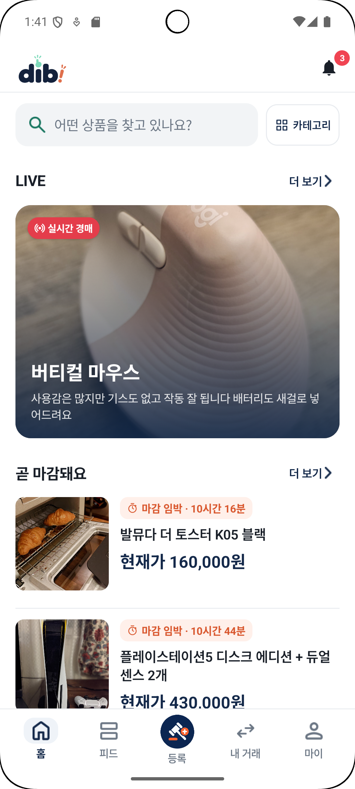<br />
      <strong>홈</strong><br />
      <sub>Live와 마감 임박 경매를 한 화면에서 탐색합니다.</sub>
    </td>
    <td align="center" valign="top" width="33%">
      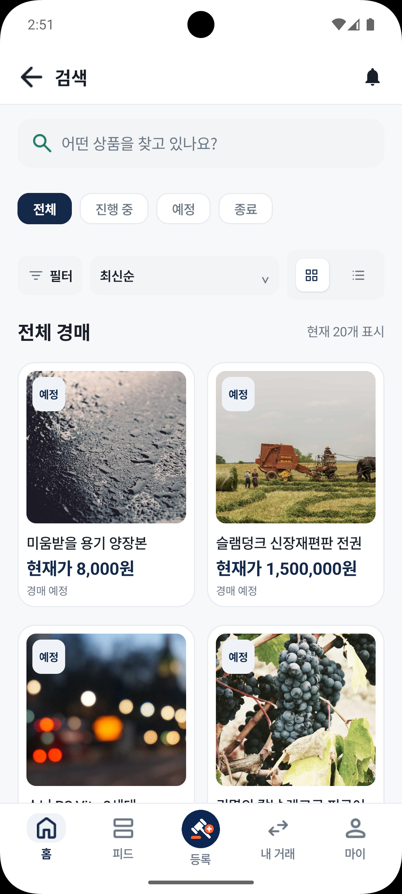<br />
      <strong>상품 검색</strong><br />
      <sub>경매 상태와 필터·정렬 조건을 선택해 상품을 찾습니다.</sub>
    </td>
    <td align="center" valign="top" width="33%">
      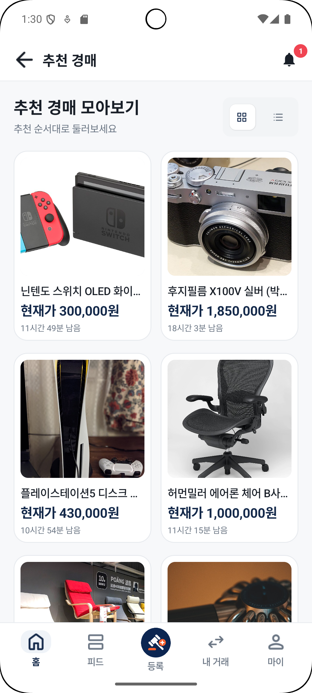<br />
      <strong>추천 경매</strong><br />
      <sub>추천 순서를 유지한 목록에서 관심 상품을 둘러봅니다.</sub>
    </td>
  </tr>
</table>

### 2. 경매와 Live 입찰

<table>
  <tr>
    <td align="center" valign="top" width="33%">
      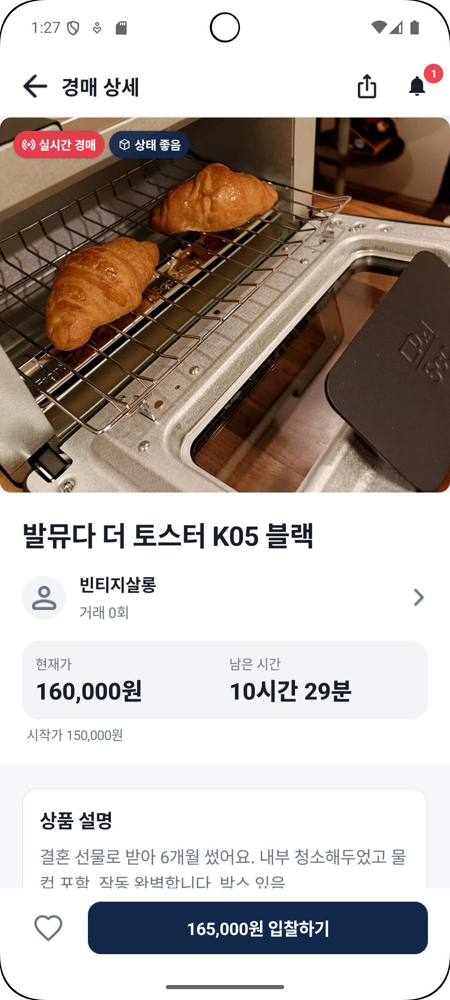<br />
      <strong>경매 상세</strong><br />
      <sub>상품 정보와 판매자, 현재가를 확인하고 입찰합니다.</sub>
    </td>
    <td align="center" valign="top" width="33%">
      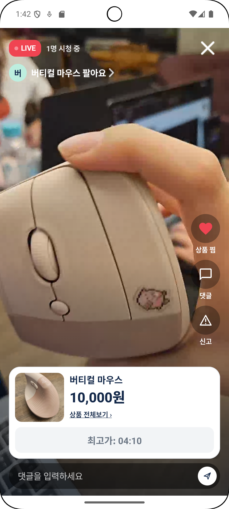<br />
      <strong>Live 방송</strong><br />
      <sub>방송을 보며 상품을 확인하고 댓글로 소통합니다.</sub>
    </td>
    <td align="center" valign="top" width="33%">
      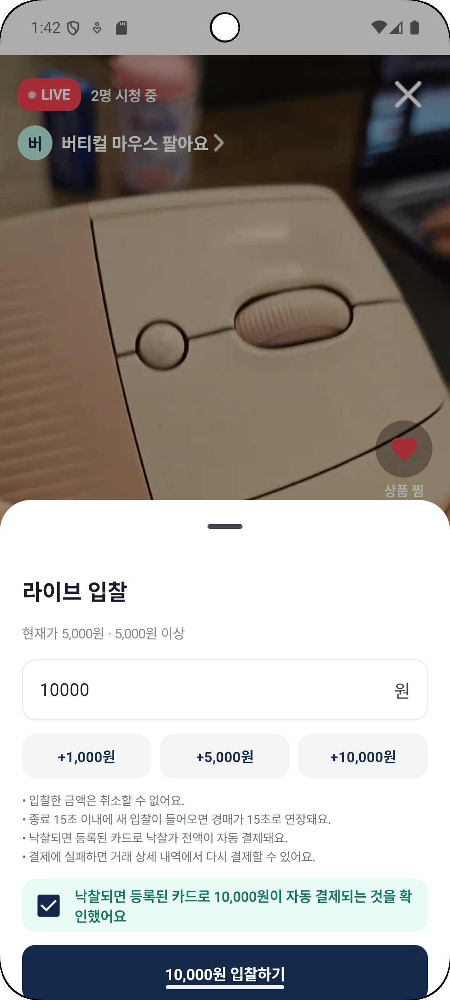<br />
      <strong>Live 입찰</strong><br />
      <sub>입찰 금액과 낙찰 시 결제 안내를 확인하고 참여합니다.</sub>
    </td>
  </tr>
</table>

### 3. 상품 등록과 AI 검수

<table>
  <tr>
    <td align="center" width="40%">
      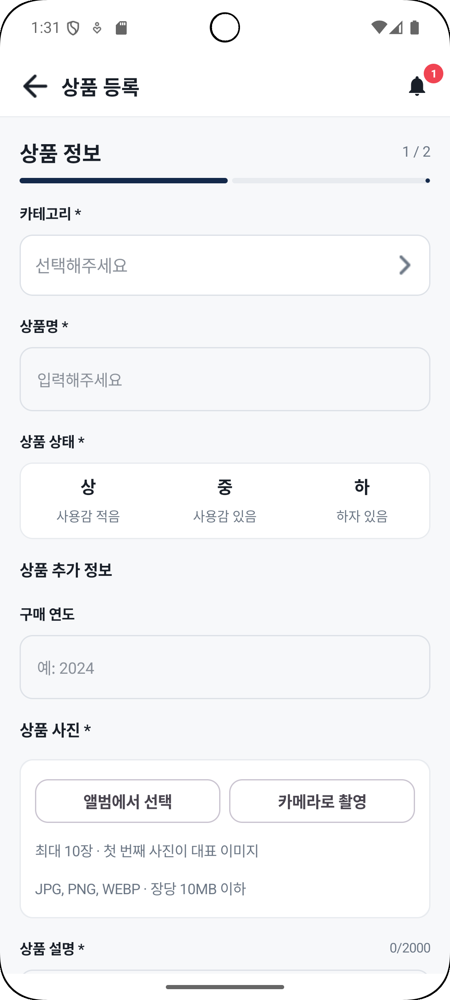
    </td>
    <td valign="middle" width="60%">
      <strong>판매할 상품 등록</strong><br />
      카테고리, 상품명, 상품 상태와 사진을 입력합니다.<br /><br />
      <strong>규칙과 AI로 상품 검수</strong><br />
      규칙으로 거래 제한 품목을 먼저 확인하고, AI가 상품명·설명·사진을 함께 살펴 승인·반려·검토 대기 상태를 결정합니다.<br /><br />
      <strong>관리자의 최종 검토</strong><br />
      판단이 어려운 상품은 관리자가 검수 사유를 확인한 뒤 승인하거나 반려합니다. AI를 사용할 수 없는 경우에도 상품을 검토 대기 상태로 남겨 수동으로 처리할 수 있습니다.
    </td>
  </tr>
</table>

### 4. 낙찰부터 거래 완료까지

<table>
  <tr>
    <td align="center" valign="top" width="33%">
      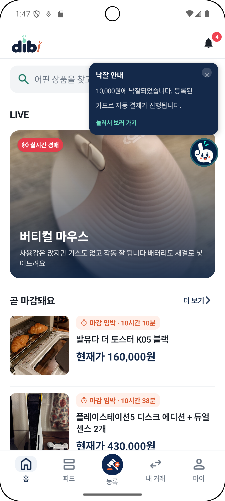<br />
      <strong>낙찰 안내</strong><br />
      <sub>낙찰 결과와 결제 안내를 확인하고 거래 상세로 이동합니다.</sub>
    </td>
    <td align="center" valign="top" width="33%">
      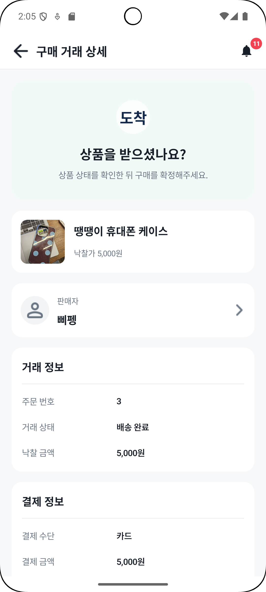<br />
      <strong>배송과 구매 확정</strong><br />
      <sub>배송 상태를 확인하고 상품을 받은 뒤 구매를 확정합니다.</sub>
    </td>
    <td align="center" valign="top" width="33%">
      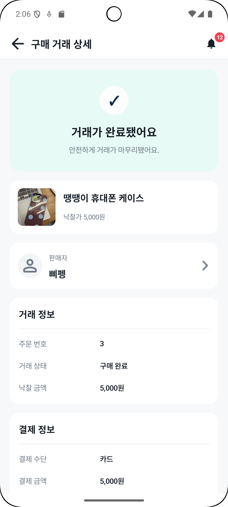<br />
      <strong>거래 완료</strong><br />
      <sub>거래 완료 결과와 주문·결제 정보를 확인합니다.</sub>
    </td>
  </tr>
</table>

### 5. 찜·거래 채팅·알림

<table>
  <tr>
    <td align="center" valign="top" width="33%">
      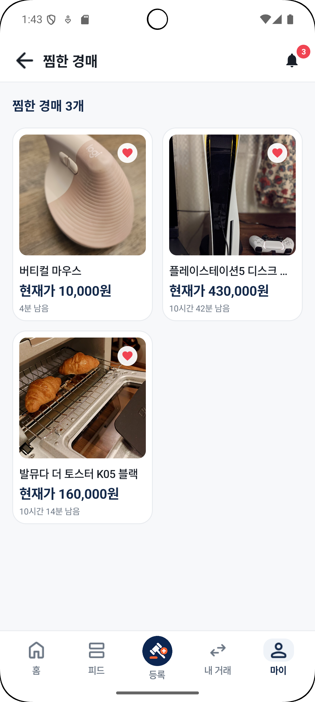<br />
      <strong>찜한 경매</strong><br />
      <sub>관심 상품을 모아 현재가와 남은 시간을 확인합니다.</sub>
    </td>
    <td align="center" valign="top" width="33%">
      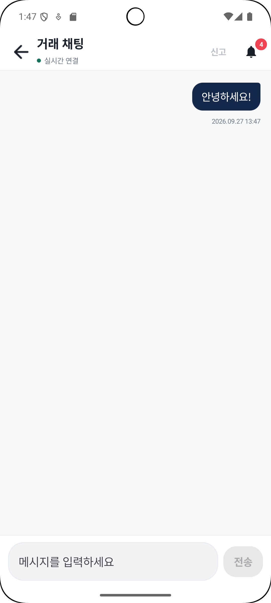<br />
      <strong>거래 채팅</strong><br />
      <sub>거래 상대와 메시지를 주고받습니다.</sub>
    </td>
    <td align="center" valign="top" width="33%">
      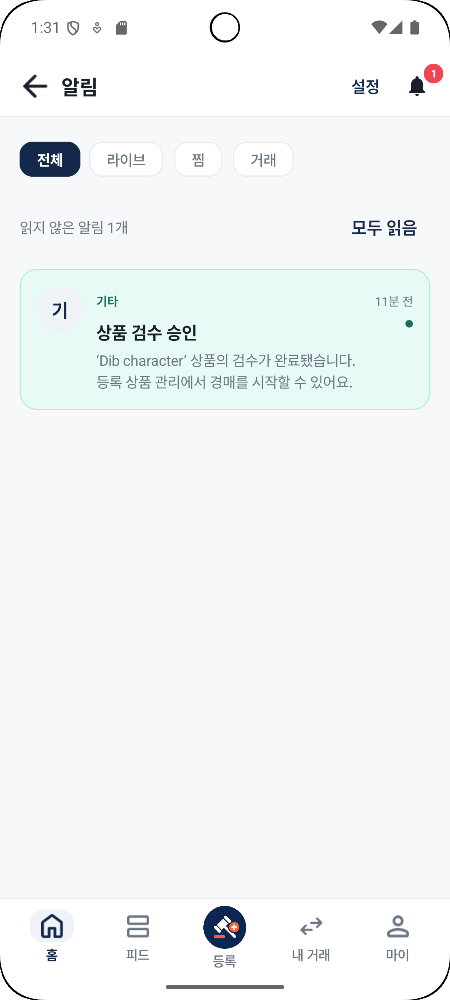<br />
      <strong>알림</strong><br />
      <sub>상품 검수 결과와 경매·거래의 변경 사항을 확인합니다.</sub>
    </td>
  </tr>
</table>

### 6. 관리자 운영 콘솔

| 운영 업무 | 처리 내용 |
| --- | --- |
| 상품 검수 | AI 판정 근거와 보류·반려 사유를 확인하고 승인 또는 반려합니다. |
| 이상 입찰 | 위험 점수와 탐지 사유를 조사하고 필요한 회원 조치로 연결합니다. |
| 고객 문의 | 고객 문의를 확인하고 답변합니다. |
| 신고와 회원 관리 | 신고 판정, 환불과 회원 정지·제명·정지 해제를 처리합니다. |

---

<a id="technology-stack"></a>

## 🛠️ 기술 스택

<table>
  <tr><th width="20%">분류</th><th>기술</th></tr>
  <tr>
    <td><strong>Android App</strong></td>
    <td>
      
      
      
    </td>
  </tr>
  <tr>
    <td><strong>Admin Web</strong></td>
    <td>
      
      
      
    </td>
  </tr>
  <tr>
    <td><strong>Backend</strong></td>
    <td>
      
      
      
      
    </td>
  </tr>
  <tr>
    <td><strong>AI</strong></td>
    <td>
      
      
      
      
      
    </td>
  </tr>
  <tr>
    <td><strong>Data &amp; Messaging</strong></td>
    <td>
      
      
      
      
    </td>
  </tr>
  <tr>
    <td><strong>Realtime &amp; Integration</strong></td>
    <td>
      
      
      
      
    </td>
  </tr>
  <tr>
    <td><strong>Infrastructure</strong></td>
    <td>
      
      
      
      
      
    </td>
  </tr>
</table>

---

<a id="system-architecture"></a>

## 🏗️ 시스템 아키텍처

### 서비스 구성

[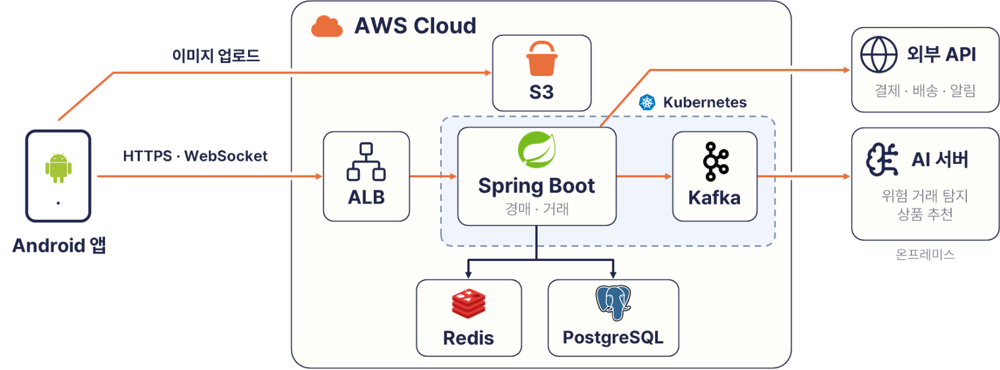](docs/assets/readme/architecture/system-architecture.png)

### 인프라 구성

[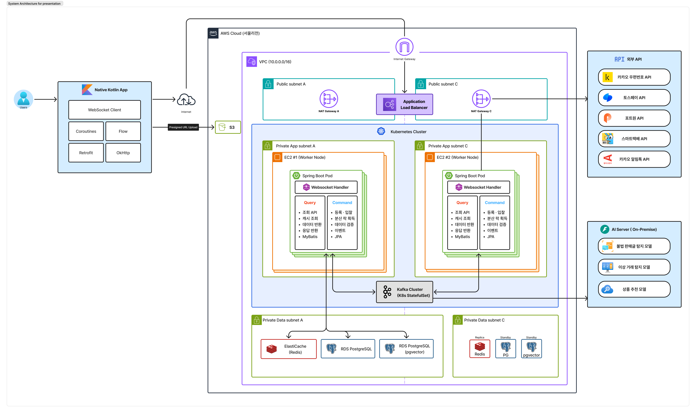](docs/assets/readme/architecture/infrastructure-architecture.png)

이미지를 클릭하면 원본 크기로 볼 수 있습니다.

---

<a id="erd"></a>

## 🗄️ ERD

[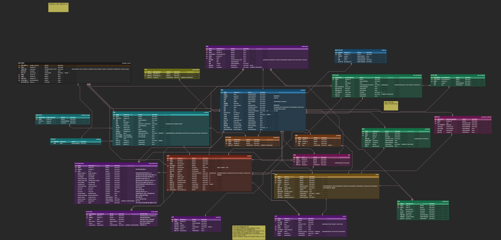](docs/assets/readme/database/erd.png)

이미지를 클릭하면 테이블과 관계를 원본 크기로 확인할 수 있습니다.

---

<a id="technology-details"></a>

## 🔬 핵심 기술

### 1. 실시간 입찰

Redis 분산 락과 PostgreSQL 트랜잭션으로 동시 입찰을 처리하고, WebSocket으로 현재가와 경매 상태를 실시간 전달합니다. 알림과 행동 기록 같은 후속 작업은 Kafka로 처리합니다.

### 2. Live 방송 경매

LiveKit으로 영상과 음성을 송출하고, WebSocket/STOMP로 댓글과 입찰 정보를 주고받습니다. 판매자와 시청자의 권한을 구분해 방송과 경매 참여를 연결했습니다.

### 3. AI 상품 검수

텍스트 정규화와 Aho-Corasick 금칙어 필터로 거래 제한 품목을 먼저 확인하고, 멀티모달 AI가 상품명·설명·사진을 함께 검수합니다. 판단이 불확실한 상품은 관리자가 확인하도록 했습니다.

### 4. 이상 입찰 탐지

규칙 엔진으로 재입찰 간격과 판매자 편중 같은 위험 신호를 분석하고, LightGBM과 등조 보정으로 모델 점수를 계산합니다. 위험 점수와 탐지 사유를 함께 제공해 관리자가 검토할 수 있도록 했습니다.

### 5. 상품 추천

BGE-M3와 SigLIP으로 상품의 텍스트와 이미지를 벡터로 변환하고, 사용자 행동과 상품 유사도를 바탕으로 추천합니다. 마감 임박도·인기도·경쟁도를 함께 반영하며, 행동 기록이 부족하면 기본 추천을 제공합니다.

---

<a id="api-and-erd"></a>

## 📋 API 명세

로컬 서버를 실행하면 현재 구현의 API 명세를 확인할 수 있습니다. 기본 포트를 바꿨다면 아래 주소에도 같은 포트를 사용하세요.

| 문서 | 로컬 주소 |
| --- | --- |
| Backend Swagger UI | [http://localhost:8080/swagger-ui.html](http://localhost:8080/swagger-ui.html) |
| Backend OpenAPI JSON | [http://localhost:8080/v3/api-docs](http://localhost:8080/v3/api-docs) |
| AI OpenAPI UI | [http://localhost:8000/docs](http://localhost:8000/docs) |

요구사항과 API는 작업 시점에 공유한 최신 자료를 기준으로 확인합니다. 실행 가능한 DB 스키마와 마이그레이션은 Backend에서 관리합니다.

---

<a id="getting-started"></a>

## 🚀 개발자 가이드

<details>
<summary><strong>실행 환경과 로컬 실행·검증 방법 보기</strong></summary>

### 사전 준비

| 도구 | 용도 |
| --- | --- |
| Git | 통합 저장소와 submodule 내려받기 |
| Docker Desktop · Docker Compose | 로컬 데이터 서비스와 Backend·AI·관리자 웹 실행 |
| Android Studio · Android SDK · JDK 17 | Android 앱 빌드와 실행 |
| JDK 25 | Backend를 로컬 프로세스로 개발·검증할 때 사용 |
| Node.js · npm | 관리자 웹을 로컬 프로세스로 개발·검증할 때 사용 |
| Python | AI를 로컬 프로세스로 개발·검증할 때 사용. Compose 이미지는 Python 3.13 사용 |

### 저장소 받기

```bash
git clone --recurse-submodules https://github.com/dib-B101/dib-orchestration.git
cd dib-orchestration
```

루트 저장소만 내려받았다면 다음 명령으로 컴포넌트를 함께 가져옵니다.

```bash
git submodule update --init --recursive
```

### 로컬 통합 실행

PowerShell에서 환경 변수 예시 파일을 복사합니다.

```powershell
Copy-Item .env.example .env
```

`.env`의 `PHONE_VERIFICATION_HMAC_SECRET`, `DIB_SERVICE_HMAC_SECRET`, `DIB_AI_HMAC_SECRET`을 설정하고, 사용할 외부 연동 키를 준비합니다. 실제 비밀값은 커밋하지 않습니다.

```powershell
# PostgreSQL, Redis, Kafka만 실행
docker compose up -d

# 데이터 서비스, Backend, AI, 관리자 웹을 함께 실행
docker compose --profile app up -d --build
```

| 서비스 | 기본 로컬 주소 |
| --- | --- |
| 관리자 웹 | [http://localhost:3000/admin/](http://localhost:3000/admin/) |
| Backend | [http://localhost:8080](http://localhost:8080) |
| AI | [http://localhost:8000](http://localhost:8000) |

Android 앱은 Android Studio에서 `components/frontend/`를 열어 실행합니다. 에뮬레이터의 서버 주소 설정, Firebase 인증과 결제 연동 준비는 [로컬 실행 가이드](docs/LOCAL_SETUP.md)를 따릅니다.

### 검증

컴포넌트별 빌드·테스트 명령은 각 저장소의 README를 참고하세요. 전체 서비스의 검증 범위와 합격 조건은 [테스트 전략](docs/TEST_STRATEGY.md)에 정리되어 있습니다.

```bash
git submodule status --recursive
git diff --submodule=log
```

</details>

---

<a id="directory-structure"></a>

## 📁 디렉터리 구조

<details>
<summary><strong>전체 디렉터리 구조 보기</strong></summary>

```text
dib-orchestration/
├─ components/                  # 독립 저장소를 연결한 Git submodule
│  ├─ frontend/                 # Android 앱과 관리자 웹
│  ├─ backend/                  # Spring Boot API와 거래 처리
│  ├─ ai/                       # FastAPI 기반 검수·탐지·추천
│  └─ infra/                    # Terraform과 Kubernetes
├─ docs/
│  ├─ assets/readme/            # 서비스 화면, 팀원 이미지와 발표 자료
│  ├─ product-specs/            # 안정적인 제품 목표와 인수 조건
│  ├─ exec-plans/active/        # 진행 중인 실행 계획
│  └─ exec-plans/completed/     # 완료한 계획과 검증 기록
├─ tools/                       # 통합 QA 도구
├─ ARCHITECTURE.md              # 시스템 경계와 의존성
├─ AGENTS.md                    # 저장소 작업 규칙
├─ docker-compose.yml           # 로컬 통합 실행 구성
├─ .env.example                 # 환경 변수 예시
└─ README.md
```

</details>

---

<a id="project-guide"></a>

## 📚 프로젝트 문서와 협업 규칙

<details>
<summary><strong>문서 목록과 브랜치·커밋 규칙 보기</strong></summary>

| 문서 | 내용 |
| --- | --- |
| [제품 명세 목록](docs/product-specs/index.md) | 제품 목표, 시스템 범위와 인수 조건 |
| [시스템 아키텍처](ARCHITECTURE.md) | 컴포넌트 경계와 의존성 |
| [로컬 실행](docs/LOCAL_SETUP.md) | 환경 설정과 Android 앱 연결 |
| [테스트 전략](docs/TEST_STRATEGY.md) | 필수 검증과 통합 시나리오 |
| [배포 절차](docs/DEPLOYMENT.md) | 배포 준비와 검증 |
| [시연 절차](docs/DEMO_RUNBOOK.md) | 시연 준비와 실패 대응 |
| [실행 계획 규칙](docs/PLANS.md) | 작업 범위, 진행 상황과 결정 기록 관리 |
| [Git Flow 정책](docs/GIT_FLOW.md) | 브랜치·병합·커밋·버전 태그 |
| [GitLab 동기화](docs/GITLAB_SYNC.md) | 원본 ref 백업과 통합본 생성 |
| [에이전트 작업 지도](AGENTS.md) | 저장소와 문서의 소유권, 작업 규칙 |

### 브랜치와 커밋

`main`은 배포 가능한 안정 버전, `develop`은 다음 릴리스의 통합 기준입니다. 일반 작업은 `develop`에서 `feature/*` 브랜치를 만들고 PR을 통해 squash merge합니다. 릴리스와 긴급 수정은 각각 `release/*`, `hotfix/*` 정책을 따릅니다.

커밋 메시지는 영문 Conventional Commit 타입과 한글 설명을 사용합니다.

```text
<type>(<optional-scope>): <한글 설명>
```

정책의 원본과 병합·태그 확인 절차는 [Git Flow 정책](docs/GIT_FLOW.md)을 따릅니다.

</details>
